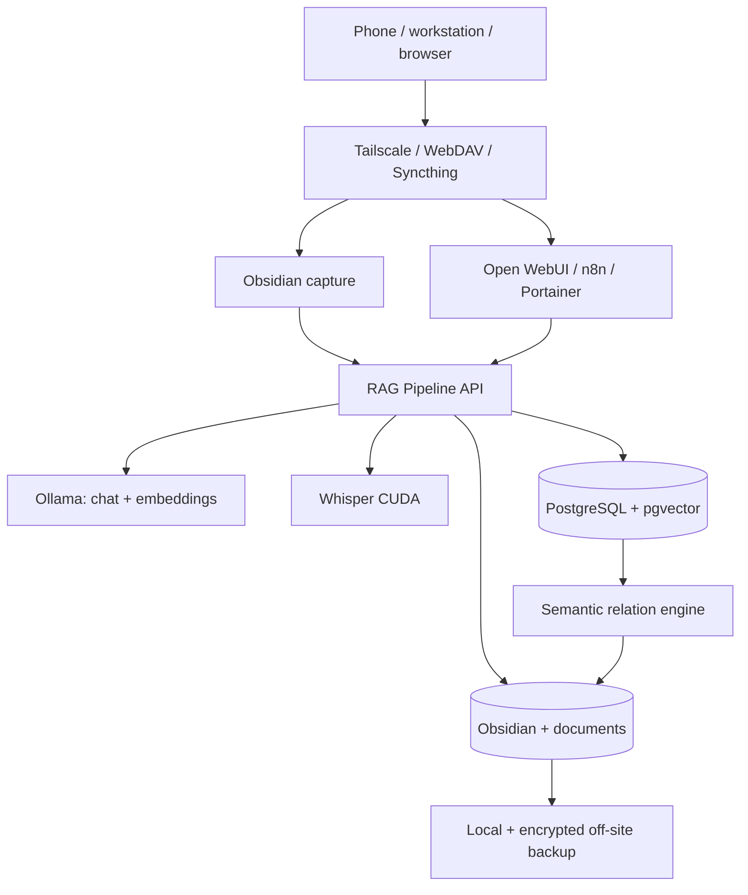
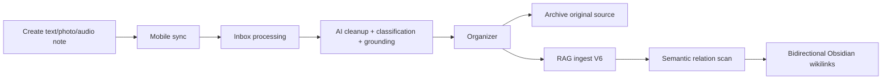
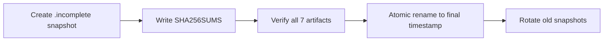

# AI Brain — Git-Safe Architecture & Operations

> **Public-safe documentation.** This README deliberately excludes private IP addresses, personal usernames, Tailscale hostnames, credentials, tokens, SSH/GPG private-key material, public-key fingerprints, internal note contents, off-site filesystem destinations, and other environment-specific confidential values.

## Status

**Release milestone:** 2026-08-10 semantic automation / zero-touch production baseline.

The base AI Brain is complete and validated end-to-end. It is a private, self-hosted knowledge and automation platform built around Docker, Ollama, Open WebUI, PostgreSQL/pgvector, n8n, Whisper, Obsidian, Syncthing, WebDAV and Tailscale.

The current production baseline adds four major capabilities beyond the original base build:

- **zero-touch source ingestion and archival** for text, photos and audio;
- **RAG ingest V6**, which separates physical-file identity from canonical semantic identity;
- **persistent semantic relations + bidirectional Obsidian wikilinks**;
- **hardened atomic local backups and verified encrypted off-site replication**.

At the final validation point the system was healthy, had no failed systemd units or monitored critical kernel events, and the semantic automation was in steady state with zero pending notes, zero Qwen verification calls and zero Markdown rewrites.

## Design goals

The project is intentionally optimized for:

1. **privacy** — primary data and inference remain under user control;
2. **recoverability** — local snapshots, encrypted off-site copy, restore testing and explicit runbooks;
3. **idempotence** — periodic automation should do nothing when nothing changed;
4. **safe incremental maintenance** — verified changes, narrow rebuild scope, no destructive storage assumptions;
5. **human-readable knowledge** — Obsidian remains a normal Markdown vault rather than a database-only memory system;
6. **model replaceability** — chat/reranker/Whisper can change independently while the production embedding contract stays explicit.

## Hardware profile

- Intel Core i9, 9th generation
- NVIDIA GeForce RTX 2080 Ti, 11 GB VRAM
- 64 GB RAM
- NVMe for OS, runtime and active model storage
- large ext4 HDD mounted at `/data` for persistent knowledge, service state and backups

## High-level architecture



## Main containers

| Container | Purpose |
|---|---|
| `ollama` | local chat, reranking and embedding inference |
| `open-webui` | primary private chat UI |
| `postgres-ai` | PostgreSQL 17 + pgvector |
| `rag-pipeline` | FastAPI ingestion, query and semantic-link API |
| `n8n` | workflow orchestration |
| `n8n-runners` | external JavaScript/Python task runners |
| `whisper` | CUDA speech-to-text |
| `syncthing` | device/vault synchronization where used |
| `webdav` | WebDAV access for mobile/Obsidian sync |
| `portainer` | Docker management UI |

## Model contract

```text
CHAT_MODEL=qwen3:8b
RERANK_MODEL=qwen3:8b
EMBEDDING_MODEL=bge-m3
WHISPER_MODEL=small
```

`bge-m3` is intentionally locked for normal operations because the production vector column is `vector(1024)`. Changing the embedding model is a schema/data migration that requires a controlled full reindex.

`OLLAMA_FLASH_ATTENTION=false` is retained because this host previously produced invalid `bge-m3` embedding output with flash attention enabled.

### Model manager

```bash
ai-model
ai-model status
ai-model list
ai-model pull "MODEL"
ai-model chat "MODEL"
ai-model reranker "MODEL"
ai-model whisper "MODEL"
ai-model reset
```

The embedding command intentionally refuses ordinary model changes.

## Persistent storage layout

```text
/data/ai/
├── backups/
├── datasets/
├── docker/
├── documents/
├── media/
├── models/
├── obsidian/
│   ├── Inbox/
│   │   ├── Text/
│   │   ├── Photos/
│   │   └── Audio/
│   ├── Processed/
│   │   └── Sources/
│   │       ├── Text/
│   │       ├── Photos/
│   │       └── Audio/
│   ├── University/
│   ├── Work/
│   ├── Projects/
│   ├── Personal/
│   ├── Reference/
│   ├── Categories/
│   └── Needs Review/
└── quarantine/
```

The bulk disk should never be reformatted or repartitioned as part of routine maintenance. Always verify device, model, size, filesystem and current mount before destructive storage commands.

## Zero-touch ingestion

The normal user workflow is capture, not SSH.



### Capture paths

- `Inbox/Text` → Qwen cleanup/classification/grounding → organizer
- `Inbox/Photos` → image preparation + Tesseract (`spa` + `eng`) → Qwen cleanup/classification/grounding → organizer
- `Inbox/Audio` → Whisper CUDA → Qwen cleanup/classification/grounding → organizer
- normal Markdown in eligible Obsidian folders → direct RAG indexing

### Original-source archival

After successful processing, source material is **moved, not deleted**, into:

```text
Processed/Sources/Text
Processed/Sources/Photos
Processed/Sources/Audio
```

The archive logic handles path safety, collisions, reference updates, atomic behavior and rollback. `Processed` is excluded from RAG indexing.

## Dynamic categories

Core categories remain:

- `University`
- `Work`
- `Projects`
- `Personal`
- `Reference`

Dynamic categories live only beneath:

```text
/data/ai/obsidian/Categories/<category>/
```

Automatic creation requires a high confidence threshold and is limited by sanitization, reserved-name checks, traversal prevention, duplicate/near-duplicate detection and a maximum category count.

```bash
ai-category
ai-category list
ai-category add "Category" "Description"
ai-category auto status
ai-category auto on
ai-category auto off
```

## RAG architecture

The query stack combines semantic and lexical retrieval:

1. `bge-m3` embedding through Ollama;
2. pgvector cosine similarity using HNSW;
3. PostgreSQL full-text search using a GIN index;
4. Reciprocal Rank Fusion (RRF);
5. Qwen reranking;
6. top context passed to the answer-generation model.

Metadata filters are applied before both retrieval branches:

```text
category
note_type
date_from
date_to
```

Primary RAG table:

```text
document_chunks
├── id
├── source_path
├── document_name
├── chunk_index
├── content
├── metadata JSONB
├── embedding vector(1024)
└── created_at
```

## Ingest V6: anti-feedback semantic identity

The key V6 change is the separation of two hashes:

- `sha256` — physical file SHA-256, including AI-managed wikilink blocks;
- `index_sha256` — canonical semantic SHA-256 used to decide whether re-embedding is necessary.

For Obsidian Markdown, the managed semantic-link block is removed before `index_sha256` is calculated. Therefore adding or changing AI-generated wikilinks changes only the physical SHA.

When semantic content is unchanged but the physical file changed, V6 performs the equivalent of:

```text
refresh metadata.sha256
skip embedding
```

This prevents the semantic-link writer from causing an ingestion feedback loop.

Managed block markers:

```html
<!-- ai-links:start -->
...
<!-- ai-links:end -->
```

## Semantic relation engine

Semantic linking is persistent, incremental and bidirectional.

### Candidate discovery

The current production policy uses:

```text
minimum vector similarity: 0.62
max candidates per note: 5
max rendered links per note: 3
max verifier calls per scan cycle: 20
verifier model: qwen3:8b
```

Supported relation decisions:

```text
a_uses_b
b_uses_a
related
none
```

`none` is deliberately persisted. A rejected pair is therefore cached instead of being sent to Qwen every minute.

### Persistent relation registry

`semantic_note_relations` stores canonical unordered note pairs with:

- relation and confidence;
- reason;
- vector similarity;
- semantic hashes for both notes;
- verifier model;
- verification/update timestamps.

A relation is fresh only while both note hashes and the verifier model still match.

### Scan state

`semantic_note_scan_state` records per-note incremental state:

- `source_path`
- `index_sha256`
- verifier model
- scan version
- candidate count
- verifier count
- last scan timestamp

A note with an unchanged hash/model/scan version is skipped entirely.

### Deduplication

Candidate pairs are canonicalized for the whole scan cycle. If A considers B and later B considers A, only the first appearance is processed. This prevents duplicate verifier calls and inconsistent overwrites.

### Rendering and reconciliation

Only current, accepted, sufficiently confident relations are rendered. The renderer creates symmetric Obsidian navigation while preserving directional meaning, for example:

```text
Knowledge used
[[Other Note]] — reason

Used in
[[Project Note]] — reverse relation
```

The reconciler performs path/symlink/root validation, writes atomically and rolls back a multi-note batch on failure. Existing AI-managed blocks are reconciled from the persistent registry so a later relation cannot silently delete an earlier one.

## Semantic API and locking

The RAG FastAPI application exposes:

```text
GET  /health
POST /process-photos
POST /ingest
POST /semantic-links
POST /query
```

`/process-photos`, `/ingest` and `/semantic-links` share the same non-blocking `flock`-based pipeline lock. A competing operation receives a `busy` response rather than racing a file write against ingestion.

## n8n orchestration

The production ingest workflow runs once per minute and is strictly sequential:


Steady-state behavior is intentionally cheap:

```text
pending notes = 0
Qwen verifier calls = 0
Markdown files modified = 0
```

The system can therefore poll frequently without repeatedly inferring or rewriting unchanged notes.

## Network and security model

- Remote administration is private through Tailscale.
- Ubuntu SSH uses public-key authentication only; password authentication and root login are disabled.
- PostgreSQL is not published to the host network.
- RAG and Whisper host APIs are loopback-only.
- Portainer and WebDAV are exposed only through private local/Tailscale paths.
- UFW remains active with default-deny behavior; logging is intentionally disabled because of a prior kernel hard-lock association with the firewall logging/printk path. This is an operational mitigation, not a proven root cause.
- IPv4 forwarding is intentionally enabled because Docker networking depends on it.
- Secrets live in protected environment/configuration files and must never be printed or committed.

### Secret-handling rule

Do not use commands that render resolved secret values merely to validate Compose. Prefer:

```bash
docker compose config -q
```

Do not publish `.env` content. If a secret is accidentally exposed in command output, rotate it rather than merely deleting the output.

## Monitoring

`/srv/scripts/ai-health.sh` checks:

- expected containers and Docker health;
- RAG, n8n, Whisper and Ollama endpoints;
- root/data disk utilization;
- RAM and swap;
- GPU temperature;
- backup age and `SHA256SUMS` presence;
- failed systemd units;
- monitored critical kernel events.

It runs from a systemd timer approximately every 30 minutes and reports through exit status/journal rather than automatically restarting services.

## Hardened local backup

`/srv/scripts/backup-ai.sh` creates seven artifacts:

```text
postgres.sql
n8n.tar.gz
open-webui.tar.gz
docker-config.tar.gz
service-state.tar.gz
knowledge.tar.gz
backup-system.tar.gz
```

Publication is atomic:



The service runs as root because the backup includes root-only configuration and service files. Final snapshot directories are root-only.

A failed run removes its `.incomplete` staging directory. Off-site selection ignores incomplete/unverified directories.

### Manual root-only verification gotcha

This is wrong because shell redirection happens before `sudo`:

```bash
sudo wc -l < /root-only/path/SHA256SUMS
```

Use a root process or pass the filename directly instead:

```bash
sudo wc -l /root-only/path/SHA256SUMS
sudo bash -c 'cd "$1" && sha256sum -c SHA256SUMS' _ /root-only/snapshot
```

## Encrypted off-site backup

The off-site workflow:

1. selects the newest completed local snapshot with a manifest;
2. verifies local SHA-256 values;
3. encrypts before transfer using a public GPG key;
4. transfers over the private Tailscale/SSH path;
5. verifies encrypted SHA-256 remotely;
6. atomically finalizes the remote filename;
7. records the last successful snapshot in a local state file.

The source server must contain only the public GPG key. The private GPG key remains on the off-site machine. The dedicated off-site SSH private key is intentionally excluded from backup archives and should be regenerated during disaster recovery.

## Restore validation

Disaster recovery has been exercised by:

- extracting backup archives into isolated temporary paths;
- restoring PostgreSQL into a temporary `pgvector/pgvector:pg17` container with no network and temporary storage;
- validating database roles, pgvector and 1024-dimensional vectors;
- destroying the test database without touching production;
- decrypting a real off-site archive on the off-site machine;
- verifying all internal SHA-256 values;
- removing temporary plaintext restore material afterward.

## Important operational quirks

### NVIDIA / `systemctl daemon-reload`

On this host, `systemctl daemon-reload` has repeatedly caused an already-running Ollama container to lose NVML access while the host GPU remains healthy.

Symptom:

```text
Failed to initialize NVML: Unknown Error
```

Recovery:

```bash
cd /srv/compose/ollama
docker compose up -d --force-recreate ollama
docker exec ollama nvidia-smi
```

Avoid restarting the full Docker daemon unless there is a separate reason to do so.

### Docker data mount dependency

Docker is configured to require the bulk-data mount before startup. Do not remove that dependency without understanding the persistent-state layout.

### Portainer path

The established Portainer Compose directory contains a historical spelling quirk. Treat the existing path as production state; do not rename it casually.

## Routine operations

```bash
# Overall health
sudo /srv/scripts/ai-health.sh

# RAG API
curl -fsS http://127.0.0.1:8000/health

# Manual pipeline operations
curl -fsS -X POST http://127.0.0.1:8000/process-photos
curl -fsS -X POST http://127.0.0.1:8000/ingest
curl -fsS -X POST http://127.0.0.1:8000/semantic-links

# Local backup
sudo /srv/scripts/backup-ai.sh

# Off-site backup
sudo /srv/scripts/ai-offsite.sh

# GPU
nvidia-smi
docker exec ollama nvidia-smi
```

## Disaster-recovery checklist

1. Provision Ubuntu and restore the intended `/data` filesystem/mount.
2. Install Docker, NVIDIA driver/runtime, Tailscale and required host utilities.
3. Restore Docker/Compose configuration to the established `/srv` paths.
4. Restore documents, Obsidian and persistent service state.
5. Restore PostgreSQL 17 + pgvector from the SQL backup.
6. Restore monitoring/backup scripts and systemd units.
7. Recreate/regenerate the dedicated off-site SSH key and authorize its public half on the off-site host.
8. Import only the public off-site GPG key on the source server; keep the private key off-site.
9. Recreate containers and validate host/container code identity for custom pipeline modules.
10. After any `daemon-reload`, explicitly check `docker exec ollama nvidia-smi` and recreate only Ollama if NVML was lost.
11. Validate `/health`, a RAG query, ingestion, semantic steady state, local backup and encrypted off-site backup.
12. Do not declare recovery complete until checksums and the final health suite pass.

## Repository safety

Never commit:

- `.env` files or resolved secret output;
- SQL dumps;
- local/off-site backup archives;
- SSH private keys;
- GPG private keys;
- private Tailscale addresses or hostnames;
- personal usernames or home-directory destinations;
- WebDAV/n8n/Portainer credentials or tokens;
- user note content;
- copied `authorized_keys` or `known_hosts` containing environment-specific data.

Recommended baseline `.gitignore`:

```gitignore
.env
*.env
*.sql
*.tar
*.tar.gz
*.gpg
*.key
id_*
known_hosts
secrets/
backups/
quarantine/
__pycache__/
*.pyc
```

Use placeholders in public examples:

```text
<SERVER_TAILSCALE_IP>
<OFFSITE_TAILSCALE_IP>
<TAILSCALE_HOSTNAME>
<SERVER_USER>
<OFFSITE_USER>
<OFFSITE_PATH>
<GPG_PUBLIC_KEY_ID>
```

## Maintenance principles

- verify before modifying;
- rebuild/recreate only the service being changed;
- keep `bge-m3`/1024-dimension compatibility explicit;
- treat `/data` as persistent production storage;
- preserve originals before destructive transformations;
- use atomic publication for generated state;
- prefer cached/idempotent semantic decisions over repeated LLM calls;
- keep AI-managed content clearly delimited from human-authored semantic content;
- keep private topology and secrets out of the public repository.

## Project state

The base AI Brain plus the zero-touch semantic-linking phase is complete. Future work should be treated as optional feature development or controlled maintenance: richer agents/tool use, improved alert delivery, additional off-site targets, a deliberate embedding migration, better note-level AI UX, or broader observability.
